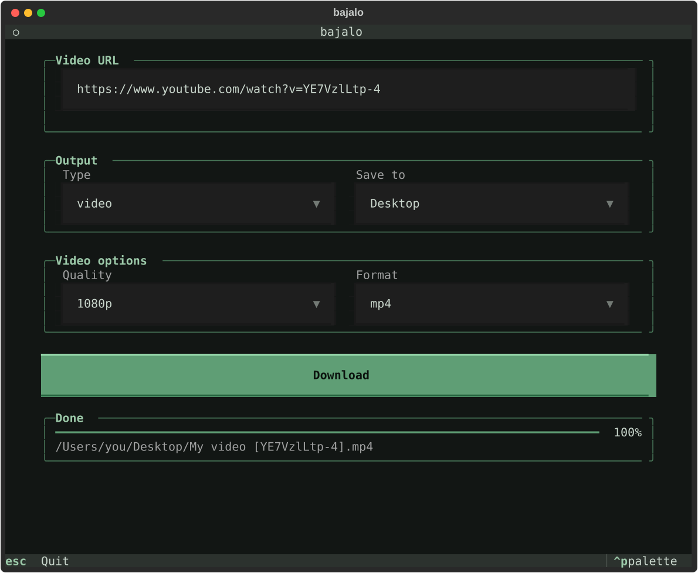

# bajalo

Download videos and audio from the terminal. `bajalo` is a small wrapper around [yt-dlp](https://github.com/yt-dlp/yt-dlp) with two ways to use it:

- **`bajalo`** (or `bj`): a CLI that asks a few questions and downloads.
- **`bajalo-tui`** (or `bjt`): a full-screen terminal UI built with [Textual](https://textual.textualize.io/).

Both work with any site yt-dlp supports (YouTube, Instagram, and many more).



## Requirements

- Python 3.11 or newer
- [ffmpeg](https://ffmpeg.org/), used to merge video and audio and to convert audio (`brew install ffmpeg` on macOS)

## Install

With [pipx](https://pipx.pypa.io/), which keeps it in its own environment:

```bash
pipx install git+https://github.com/thaishdz/bajalo.git
```

## Usage

### TUI

```bash
bjt
```

1. Paste the URL.
2. Choose **video** or **only audio**, and where to save it.
3. Pick the options for that type and press **Download**.

Quit with `Esc` (or `Ctrl+Q`).

### CLI

```bash
bj
```

It asks for the same things step by step. Press `Ctrl+C` to cancel; run it again with the same URL to resume.

### Quality and formats

- **Quality** (1080p or 720p) picks the best version up to that resolution, measured on the short side, so vertical videos (reels, Shorts) work too.
- **mp4** prefers H.264/AAC so the file plays everywhere, even if that means a lower resolution than the one asked for. Choose **auto** for the highest quality.

## Development

```bash
git clone https://github.com/thaishdz/bajalo.git
cd bajalo
python -m venv .venv
source .venv/bin/activate
pip install -e ".[dev]"
```

Run the checks (the same ones CI runs):

```bash
ruff check src tests
ruff format --check src tests
pytest
```
